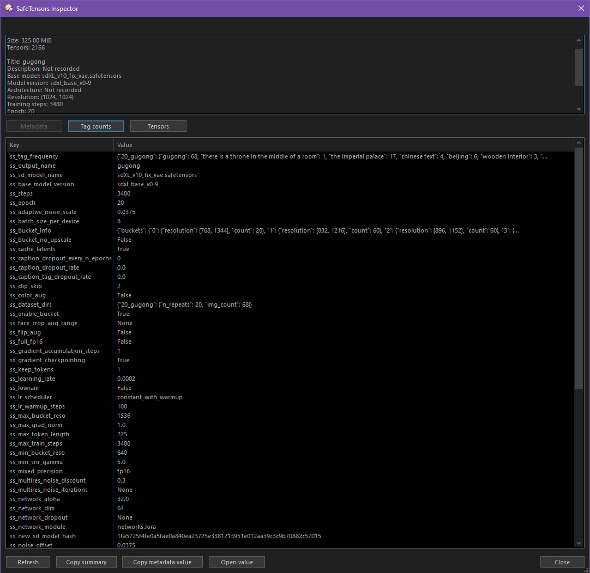
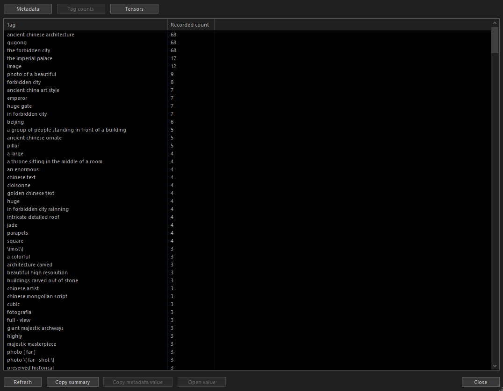

# Directory Opus Metadata Inspectors

Inspect `.safetensors` files directly in [Directory Opus](https://www.gpsoft.com.au/), with a focus on trained LoRAs and models used in ComfyUI, such as SDXL and Flux.2 Klein. View the recorded base model, training steps, datasets, tag frequencies, and other embedded metadata without leaving the file manager.

Work in progress.

## Preview

SafeTensors metadata inspector:



Recorded training tag counts:



## Implemented

- Inspect SafeTensors model information, training metadata, recorded tag counts, and tensor details.
- Browse nested JSON metadata and copy full values.
- Follow file selections in Directory Opus and set which metadata fields appear first.

## Planned

- Read media metadata, including embedded ComfyUI workflows, models, and prompts.
- Show metadata in custom Directory Opus columns.

## Directory Opus

Requires Directory Opus 12.21 or later.

1. Open `/dopusdata/Script AddIns` in Directory Opus.
2. Copy `src/InspectSafeTensors.js` and `src/Get-SafeTensorMetadata.ps1` into that folder.
3. Enable **SafeTensors Metadata Inspector** in the Scripts settings if needed.
4. Create a toolbar button with the command `InspectSafeTensors`.

Select one `.safetensors` file and click the button. The inspector updates as you select files in the same tab.

- Switch between **Metadata**, **Tag counts**, and **Tensors** using the buttons above the table. Resize the window for more space.
- Double-click a metadata row, or select it and click **Open value**, to read its full value.
- For JSON fields, click a group to fold or unfold it. **Expand all** and **Collapse all** apply to the whole value. Double-click a plain value to read its full text; **Back** returns to the entries.
- **Copy metadata value** copies the full value, including anything shortened in the table preview. In the value window, **Copy value** copies the selected entry or the text being displayed.
- **Refresh** rereads the selected file.

To change which metadata fields appear first, edit **PriorityFields** in the add-in's settings under Preferences > Scripts. Enter the field names in order, separated by commas, for example `ss_tag_frequency, modelspec.title, ss_datasets`. Fields not listed follow alphabetically.

## PowerShell

The metadata reader can also be run on its own:

```powershell
$result = .\src\Get-SafeTensorMetadata.ps1 -Path 'C:\Models\example.safetensors'
$result.Metadata | Format-List
```

## Metadata

Metadata availability depends on the file format, the training tool, and its export settings. Different trainers may record different fields or use different names for the same information. Some models contain little or no embedded metadata.

Training tags and their frequencies do not necessarily correspond to a model's trigger words.
